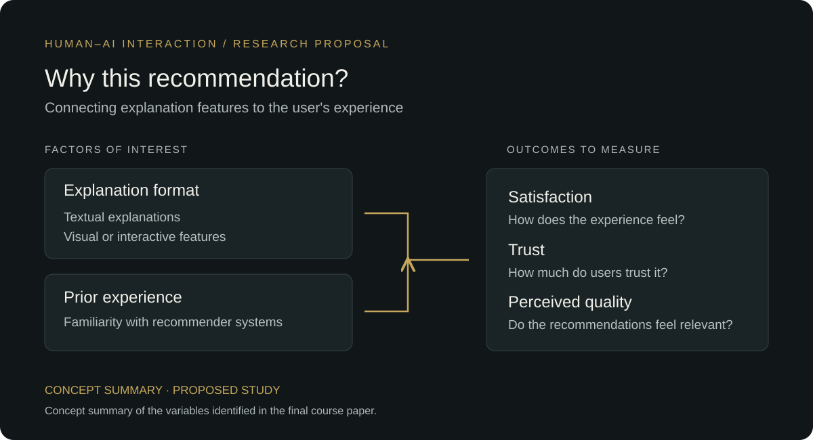

# Explainable AI & User Trust

**HCC 8330: Research Methods in Human-Centered Computing · Clemson University · Fall 2023**

A group research proposal examining how explanations in movie recommender systems could affect user satisfaction, trust and perceived recommendation quality.

**[Read the final paper](paper/final-proposal.pdf)** · **[View the blank questionnaire](materials/questionnaire.pdf)** · **[Portfolio case study](https://ralphugboko.dev/projects?discipline=school-projects&project=xai-user-trust)**

## Research question

How do explainable AI features affect user satisfaction, trust and judgments of recommendation quality?

The proposal considers textual and visual or interactive explanations, along with prior experience using recommender systems. Netflix and MovieLens were the named study platforms. The intended comparison connects the presentation of explanations to the user's experience of recommendations.

## Project scope

The completed project consists of a research proposal and supporting study materials. The participant study was not conducted. Sample sizes, schedules and results in the proposal describe plans or illustrative expected results.

The manuscript's full title is *Experimental Insights on the Effects of Explainable AI Features on User Satisfaction, Trust, and Accuracy of Recommendations in Recommender Systems*. Its user-report measures address perceived recommendation quality; they do not establish objective model accuracy.

## My contribution

I wrote the abstract, introduction and methodology, and contributed to the literature review. My focus was framing the research problem and describing the question, hypotheses, variables, proposed participants, procedure and analysis.

The paper's contribution statement records the team's responsibilities:

| Team member | Documented contribution |
| --- | --- |
| Raphael M. Ugboko | Abstract, introduction, methodology and parts of the literature review |
| Laila M. Shafiee | Related work, limitations, ethics application, recruitment message and consent materials |
| Cecilia Delgado-Solorzano | Expected results, discussion, contribution statement and questionnaire |

The team shared brainstorming, article reading, asynchronous coordination, editing and final review.

## Approach

1. **Review prior work.** Search IEEE, ACM and Google Scholar for research on explanations, recommender systems and user experience.
2. **Define the comparison.** Identify explanation format and prior experience as factors of interest; satisfaction, trust and recommendation quality as outcomes.
3. **Plan participation.** Describe recruitment, baseline questions, group assignment, platform interactions and follow-up questionnaires.
4. **Prepare the materials.** Produce a manuscript, questionnaire and draft ethics and recruitment documents for the course submission.
5. **Describe an analysis.** Plan comparisons of questionnaire responses and categorical associations in feature awareness and use.

See the [study plan and methodological reflection](docs/study-plan.md) for the proposed workflow and refinements needed before recruitment.

## Repository contents

| File | Purpose |
| --- | --- |
| [Final proposal](paper/final-proposal.pdf) | Original submitted manuscript, including methods, references, expected-results illustrations and contribution statement |
| [Questionnaire](materials/questionnaire.pdf) | Original blank instrument prepared by the team |
| [Study plan](docs/study-plan.md) | Portfolio summary of the proposed research and methodological reflection |
| [Research map](assets/research-map.svg) | Portfolio diagram summarizing the variables identified in the proposal |
| [Source manifest](provenance.json) | Original source filenames and SHA-256 checksums for the two PDFs |

The PDFs retain their original contents. The README, study-plan summary and research map were prepared for portfolio presentation. The repository contains no recruited-participant dataset or trained recommendation model.
